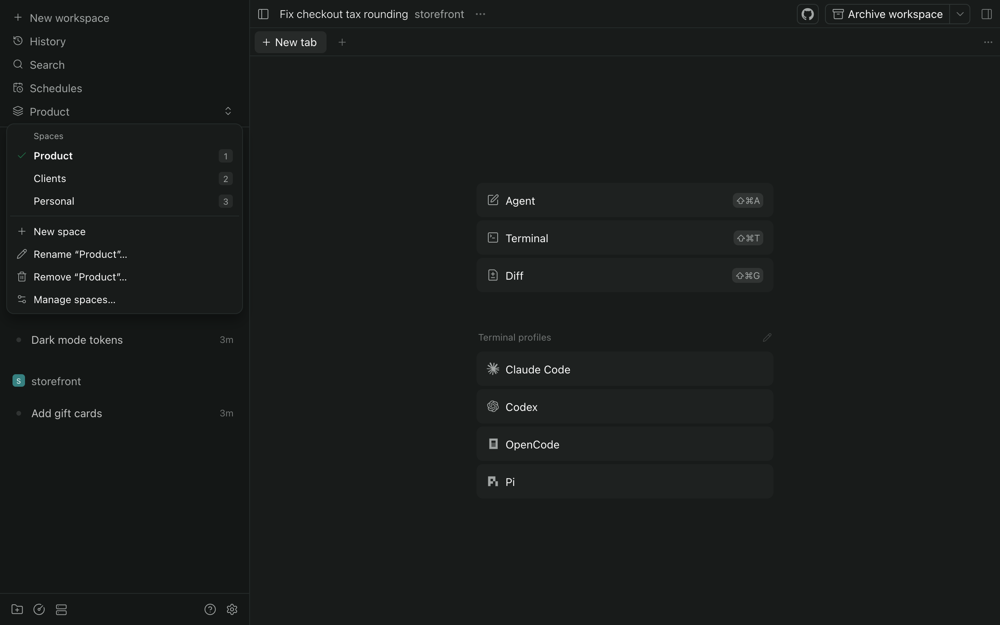

# Spaces for Paseo

Group the projects in [Paseo](https://paseo.sh)'s sidebar into Spaces, and switch between them
from a dropdown or the keyboard. Switching only changes what the sidebar shows: agents keep
running and the open chat stays put.

**Desktop and web only, for now.** Paseo's phone app doesn't let plugins change its sidebar, so
on a phone every project stays visible. The Spaces row there opens the screen where you sort
projects into Spaces.



## What it does

- **Switcher.** A sidebar header row showing the current Space. Press it for the list of Spaces,
  plus New space, Rename, Remove (with a confirmation) and Manage spaces.
- **Keyboard (desktop app on macOS).** ⌘J opens the switcher, then 1 to 9 pick a Space and focus
  goes back to where you were. ⌘⌥↑ and ⌘⌥↓ go to the previous or next Space.
- **Command center.** ⌘K lists "Switch to space: …", "New space" and "Manage spaces".
- **Sidebar.** Projects in other Spaces are hidden, the project heading shows the Space's name,
  and pinned workspaces follow their project. Each project's menu gets a "Move to space" section.
- **Manage screen.** Every Space and every project on every connected host, each with a Space
  picker. On phones, where the sidebar can't be filtered, the Spaces row opens this screen
  instead of a switcher.

Projects are matched by the key Paseo's sidebar uses for them, so a project checked out on two
hosts belongs to one Space. A project you create joins the Space you are in; projects you have
not sorted otherwise belong to the first Space.

## Install

Requires Paseo 0.15 or later.

```sh
paseo plugin add git:multiplehats/paseo-spaces
```

Plugins are off until you turn them on (`paseo daemon config set pluginsEnabled true`). The
switcher is added at the end of the sidebar header; move it with the arrows in Settings,
Sidebar, Header.

Install it on one host per desktop. Each host keeps its own Spaces, and with two copies the
sidebar would follow whichever loaded first.

## How it works

- The layout (Spaces and which project is in which) is stored in the host's plugin settings,
  with revision checks so two clients can't overwrite each other.
- The current Space is per client, remembered in local storage.
- The switcher, popover and manage screen use Paseo's plugin API. Hiding projects, renaming the
  heading and the project menu section have no API, so they work on the sidebar's own elements,
  found by the test IDs Paseo gives them. A Paseo update that changes the sidebar can break
  those parts; the switcher and manage screen keep working.
- Pinned workspaces are keyed `serverId:workspaceId`. Their project is looked up on their own
  host, so pinned workspaces from other connected hosts are placed too.

[docs/BEHAVIOUR.md](docs/BEHAVIOUR.md) describes every behaviour in detail.

## Development

```sh
npm install
npm run check                    # typecheck, lint and tests
paseo plugin add "$PWD"          # run it from this checkout
paseo plugin reload spaces       # after a change
```

Tests run in Node against a sidebar shaped like Paseo's, using
[linkedom](https://github.com/WebReflection/linkedom).

## Credits

The idea of grouping Paseo's projects into Spaces comes from
[Workspace Spaces](https://paseo.sh/plugins/hieppp/workspace-spaces) by
[HiepPP](https://github.com/HiepPP). Spaces is a separate implementation, written from scratch.

## License

[MIT](LICENSE)
